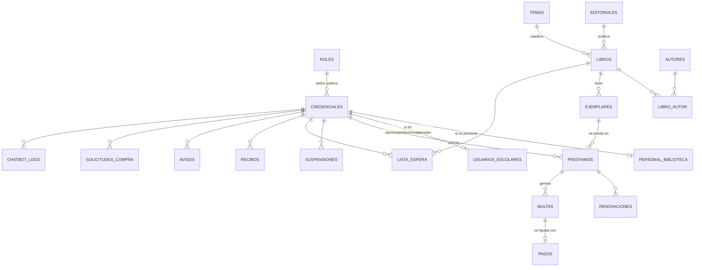

# Modelo de datos (ERD)

El esquema completo está en [db/esquema.sql](../db/esquema.sql). El diagrama sigue la notación ERD que recomienda SWEBOK 03 para el diseño estructural.

Otras tablas:
- `TIPO_CAMBIO`: cache diaria de Banxico.
- `CHATBOT_REGLAS`: base de conocimiento del chatbot.
- `BITACORA`: cada operación, como evidencia para ISO 9001.

Reglas de integridad que impone la base de datos:
- Estados válidos de ejemplar, préstamo, multa y suspensión (`CHECK`).
- ISBN de 10 o 13 dígitos.
- Una persona no puede estar dos veces en la lista de espera del mismo libro (índice único parcial).
- Un pago por multa.
- Precio en USD obligatorio en la ficha (Regla 4).

## Tablas agregadas por las historias de usuario (Evidencia 06)

| Tabla | Para qué | Historia |
|---|---|---|
| `PERFILES` | Perfiles con sus permisos; `CREDENCIALES.id_perfil` (sin perfil = perfil base de su tipo de cuenta) | HU6-SP0 |
| `HISTORIAL_CAMBIOS` | Dato anterior, dato nuevo, fecha y quién, de cuentas y libros | HU4-SP0, HU6-SP0, HU3-SP1 |
| `UBICACIONES` | Ubicaciones físicas que existen en la Biblioteca | HU1-SP1 |
| `PRESUPUESTOS`, `ORDENES_COMPRA`, `ORDEN_COMPRA_DETALLE` | Presupuesto mensual, órdenes de compra y su recepción | HU5-SP1 |
| `AVISOS_PERSONAL` | Pendientes para el bibliotecario: libros sin ubicación y libros comprados por dar de alta | HU1-SP2, HU5-SP1 |

Columnas nuevas: `CREDENCIALES.fecha_baja`, `motivo_baja` e `id_credencial_baja` (HU3-SP0); `EJEMPLARES.motivo_baja`, `fecha_baja` e `id_credencial_baja`, el estado `Dado de baja` y la ubicación opcional (HU2-SP1 y HU1-SP2).
