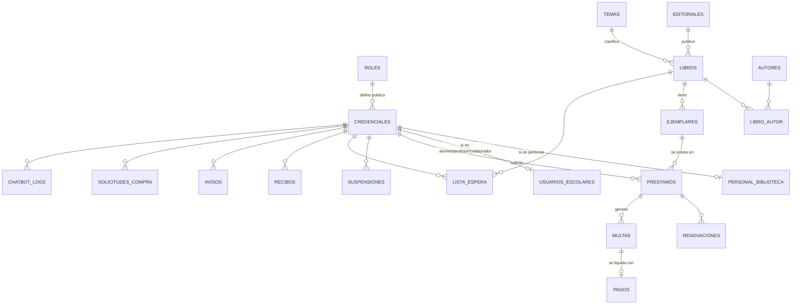

# Modelo de datos (ERD)

El esquema completo está en [db/esquema.sql](../db/esquema.sql). El diagrama sigue la notación ERD que recomienda SWEBOK 03 para el diseño estructural.

Otras tablas:
- `TIPO_CAMBIO`: cache diaria de Banxico.
- `CHATBOT_REGLAS`: base de conocimiento del chatbot.
- `BITACORA`: cada operación, como evidencia para ISO 9001.

Reglas de integridad que impone la base de datos:
- Estados válidos de ejemplar, préstamo, multa y suspensión (`CHECK`).
- ISBN de 10 o 13 dígitos.
- Una persona no puede estar dos veces en la lista de espera del mismo libro (índice único parcial).
- Un pago por multa.
- Precio en USD obligatorio en la ficha (Regla 4).
